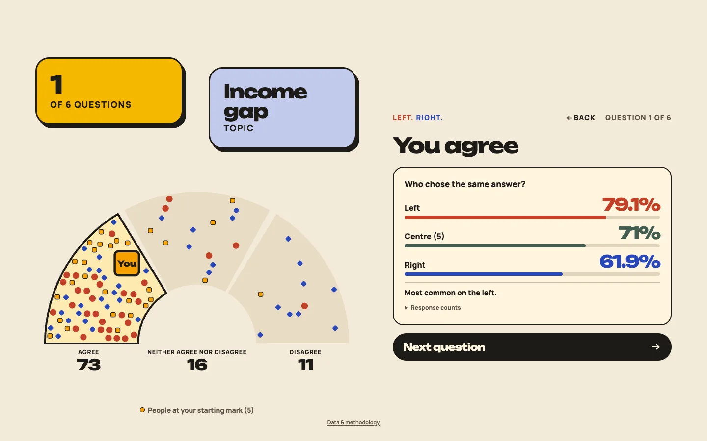
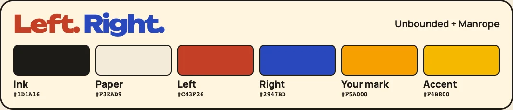

# Left. Right.

An interactive story about how much a political label tells you. Place yourself on the arc, answer six questions from the European Social Survey, and compare your answers with those of people on either side.

**[Play the story](https://imax1s.github.io/left-right-ess/)** · [Explore the data and methodology](https://imax1s.github.io/left-right-ess/#/about)



## The visual identity



The arc borrows its shape from a parliamentary seating chart. Red circles and blue diamonds carry each respondent’s original political side as the dots move into answer groups. Orange follows the reader and the people who chose the same starting mark. **Unbounded** sets the headlines and large numbers. **Manrope** sets the labels and body copy.

## From the survey to the arc

| Stage | People | Coverage |
| --- | ---: | --- |
| ESS11 extract | 50,116 records | 30 countries in the checked-in extract |
| Eligible for the comparison | 22,123 respondents | The 22 EU member states present in that extract, with valid age and weight and self-placement of 0–4 or 6–10 |
| Drawn on the arc | 100 dots | One respondent per dot, with at least one dot for every selected country |

The current comparison excludes the midpoint of the political scale (5). For each question, percentages use the respondents from the eligible pool whose answers fall into either displayed group. Neutral, missing and other responses outside those groups are excluded for that question. Estimates pool the 22 countries using the ESS analysis weight (`pspwght × pweight`). The counts beside the percentages are unweighted.

The arc is a deterministic weighted sample. After giving each country a place, the sampler allocates the other dots as close as possible to each country’s share of the survey weight. You can highlight a country, age group, gender, education level or religiosity level on the arc. The country filter changes the highlights on those 100 dots. The survey percentages continue to describe the pooled comparison.

Adapted from [European Social Survey Round 11, edition 4.2](https://doi.org/10.21338/ess11e04_2), 2023–2024, under [CC BY-NC-SA 4.0](https://creativecommons.org/licenses/by-nc-sa/4.0/). ESS ERIC and CST are not responsible for this adaptation or interpretation.

## Run locally

Requires Node 22.22.0 or newer.

```sh
npm ci
npm run dev
npm run verify
```

`npm run verify` type-checks the project, runs the tests and builds the site into `dist/`. Use `npm run preview` to serve that build locally.

### Configure the story

Edit [story.config.ts](story.config.ts). Vite rebuilds the prepared data when the configuration changes.

- `questions` sets the questions and their order. The [ESS11 catalogue](src/ess/questions.ts) defines prompts, answer labels and grouping rules.
- `countries` sets the country scope and which countries can be highlighted.
- `dotCount` sets the size of the visual sample and must be at least the number of selected countries.

The build reads the compact extract in [data/ess11.json](data/ess11.json). To regenerate it from the official edition 4.2 CSV, run `python3 scripts/import-ess11.py /path/to/ESS11e04_2.csv`. The importer verifies the two weight factors against the official analysis weight. The profile filters use ESS fields `gndr`, `agea`, `eisced` and `rlgdgr`.

### Code map

| Path | Responsibility |
| --- | --- |
| [src/domain](src/domain) | Survey adapter interface, weighted comparisons and deterministic sampling |
| [src/ess](src/ess) | ESS11 adapter, raw response codes and profile groupings |
| [src/story](src/story) | Session state, React screens and methodology |
| [src/visualization](src/visualization) | Dot positions, answer groups and arc rendering |
| [vite.config.ts](vite.config.ts) | Builds `story.json` with the dot sample and aggregate statistics |

### GitHub Pages

Select **GitHub Actions** as the Pages source. Pull requests and pushes to `main` run verification. Run **Build and publish** manually from the default branch to deploy `dist/`.

The [arc-before-centre-redesign snapshot](https://github.com/Imax1S/left-right-ess/tree/arc-before-centre-redesign) pins the published two-group edition before work on the centre and the finale.

### Credits

Manrope and Unbounded are distributed by Fontsource under the SIL Open Font License. See the [font notices](public/LICENSE-FONTS.txt). An [earlier release](https://github.com/Imax1S/left-right-ess/tree/531850324ac64a003163966b349ef478f917756b) included Canvas code adapted from [The Pudding’s Life After](https://github.com/the-pudding/lifeafter). Its notice is retained in [LICENSE-THE-PUDDING.txt](LICENSE-THE-PUDDING.txt).
