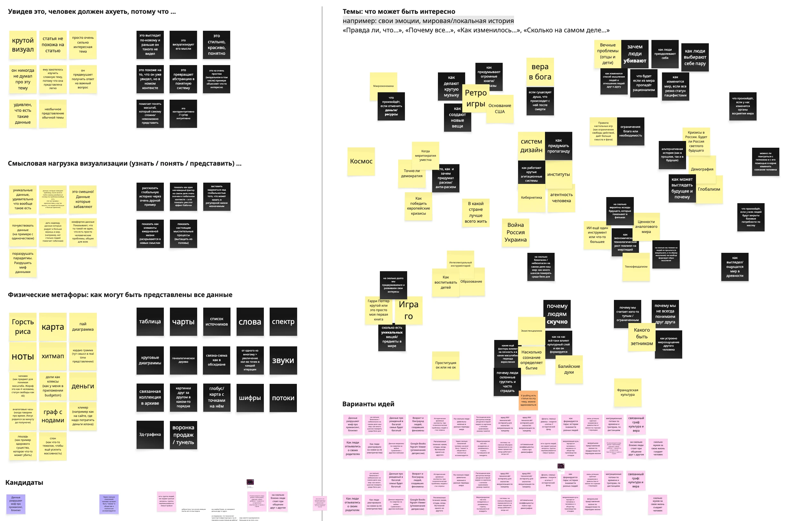
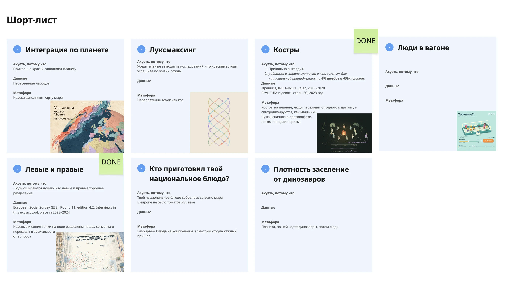
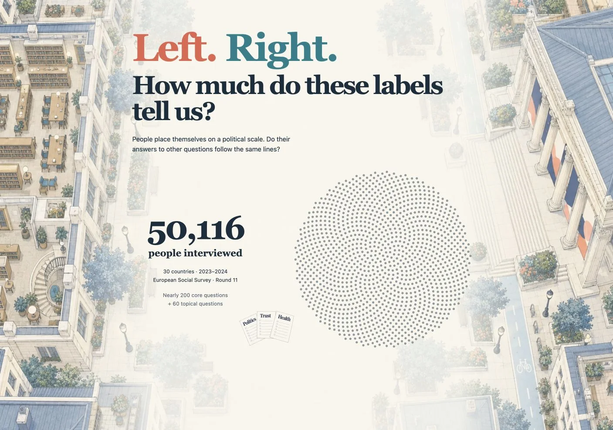
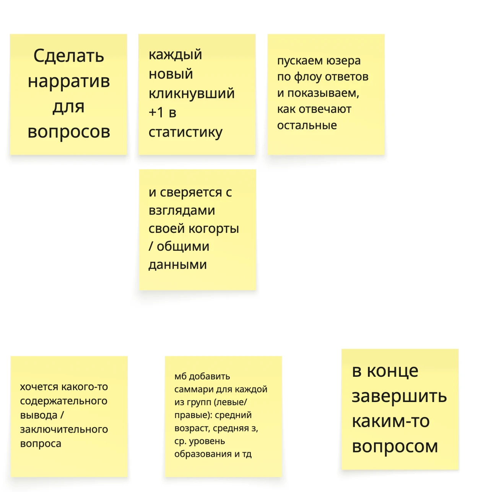
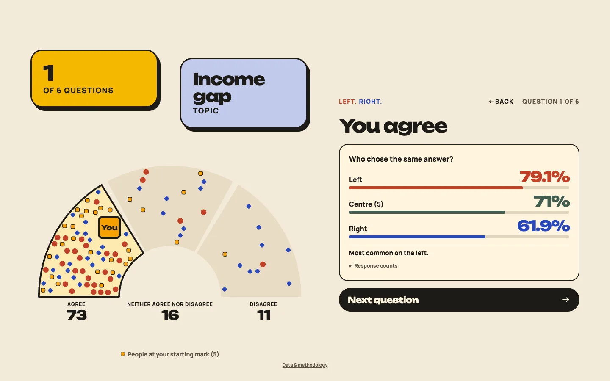
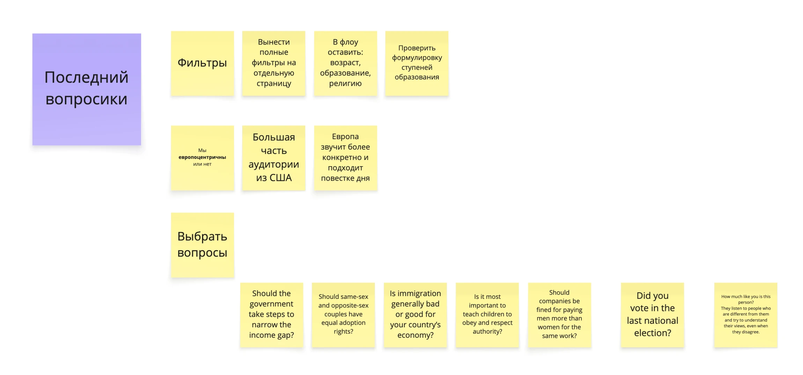

# Left. Right. drafts and process notes

These notes follow *Left. Right.* through the Miro board, the first published version and the redesign.

## The Miro brainstorm

The left side of the board collects story ideas and ways to show data, from maps to dots moving on a field.

The *Left. Right.* card in the shortlist names ESS Round 11 as the source and sketches a scene where the red and blue dots move as the questions change.

## The first published draft

The first version opened on an illustrated square and followed the same survey respondents as the reader scrolled through questions. Their original left or right colour travelled with them when they regrouped by answer. The opening explained the survey before the reader explored the people in it.

[First published version in the repository, November 2, 2026](https://github.com/Imax1S/left-right-ess/tree/531850324ac64a003163966b349ef478f917756b)

## Putting the reader in the arc

The Miro notes propose letting readers answer first, then showing how their choices compare with their own political group and the survey overall. Other stickies ask for a closing question and flag the slow movement of the dots. A live tally of visitor answers was one idea on the board. The published percentages come from the ESS sample.

The redesign starts with one decision. The reader chooses a place on the same 0–10 scale the survey used. On each question, their orange marker moves alongside respondents who chose the same answer. Each respondent carries their original political group into the new arrangement.

The first arc compared two sides. The next draft gave people who chose 5 a place of their own and put middle answers in the space between the answer bands. These are two different choices a person can make. Someone on the right can give a middle answer, and someone at 5 can agree or disagree. The income-gap reveal in the six-question draft shows all three political groups in the same answer chart.

[Two-group arc snapshot](https://github.com/Imax1S/left-right-ess/tree/arc-before-centre-redesign) · [Changes that added the centre and middle answers](https://github.com/Imax1S/left-right-ess/commit/fe7225156b6a31fdbf3fad1c66fdc21e0afb2770)

## Ending with the people the scale leaves out

The question draft in Miro runs from income inequality, adoption and immigration through obedience and equal pay. It then turns to voting and ends with a question about trying to understand people you disagree with. The notes above the row weigh how much filtering to include in the story and whether to keep the focus on Europe.

One draft moved the dots from the arc into a four-quadrant chart. The next version dropped that chart and kept the familiar seating plan when it introduced people without a recorded left–right mark. Yellow dots illustrate their weighted share. After the reader answers the closing question, the arc closes into a circle.

[Four-quadrant draft](https://github.com/Imax1S/left-right-ess/tree/720af6757b2ba5fe9dcbbfc8b7c89e67c6814475) · [Revision that kept the interlude inside the arc](https://github.com/Imax1S/left-right-ess/commit/ceff2cbfac73496a4846c3d1ec2128635d2aa404)

## Data notes

The arc follows 100 survey respondents in the main sequence. The percentages use weighted answers from the full eligible pool across 22 EU countries. The final circle also counts valid answers from people without a left–right mark. The methodology page documents the filters, response groupings and denominators. [Data and methodology](https://imax1s.github.io/left-right-ess/#/about)

The repository contains the [ESS11 extract](../data/ess11.json), the [import script](../scripts/import-ess11.py) and the [story configuration](../story.config.ts). The survey source is [European Social Survey Round 11, edition 4.2](https://doi.org/10.21338/ess11e04_2).
